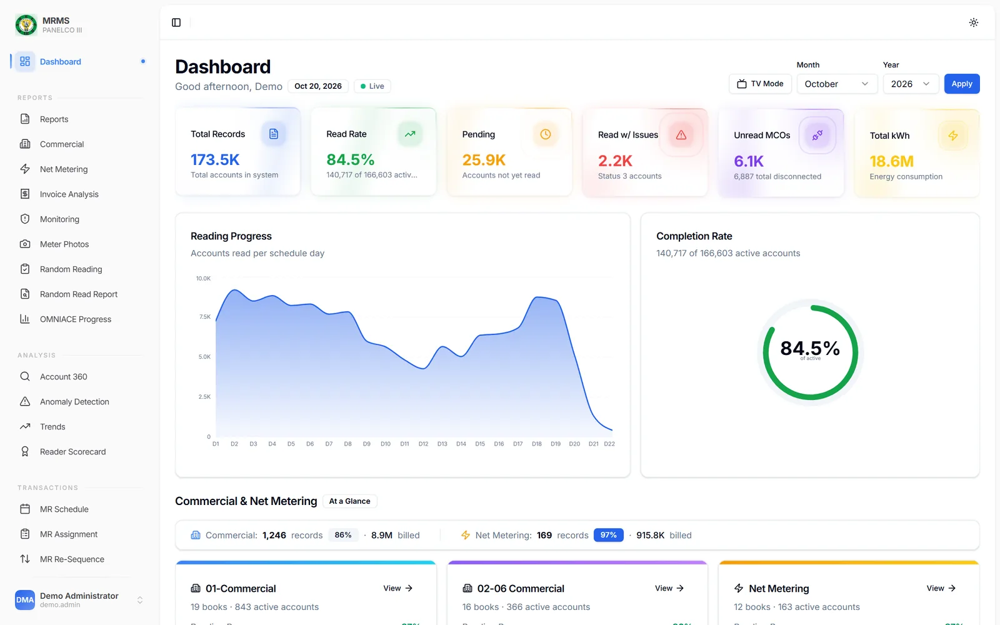
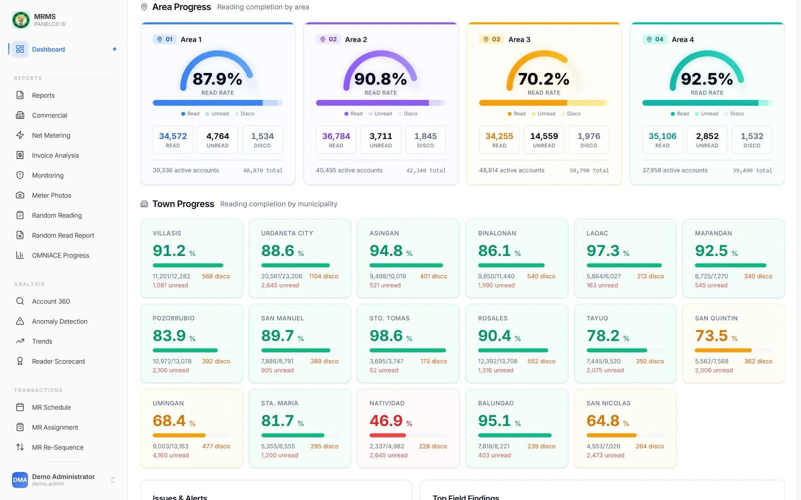
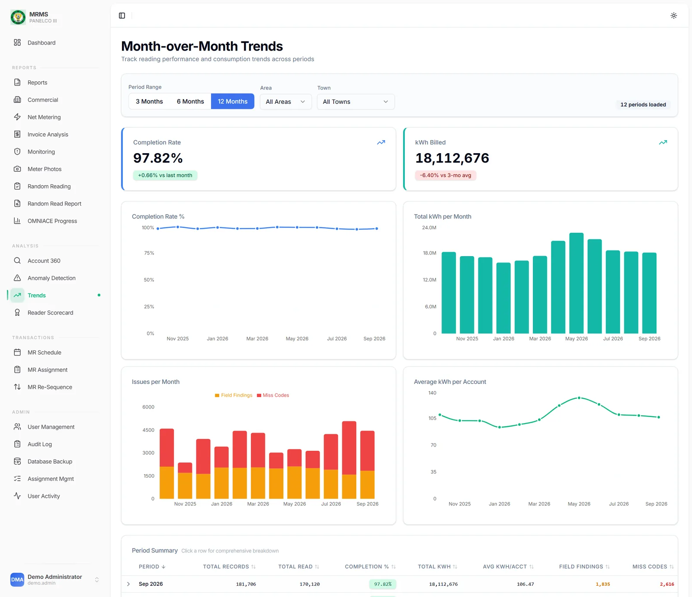
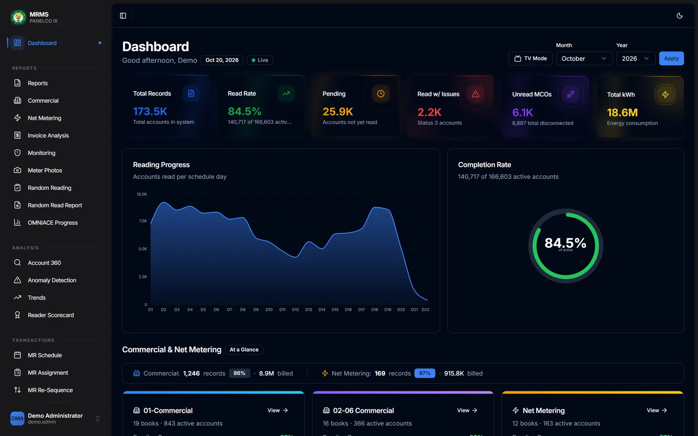
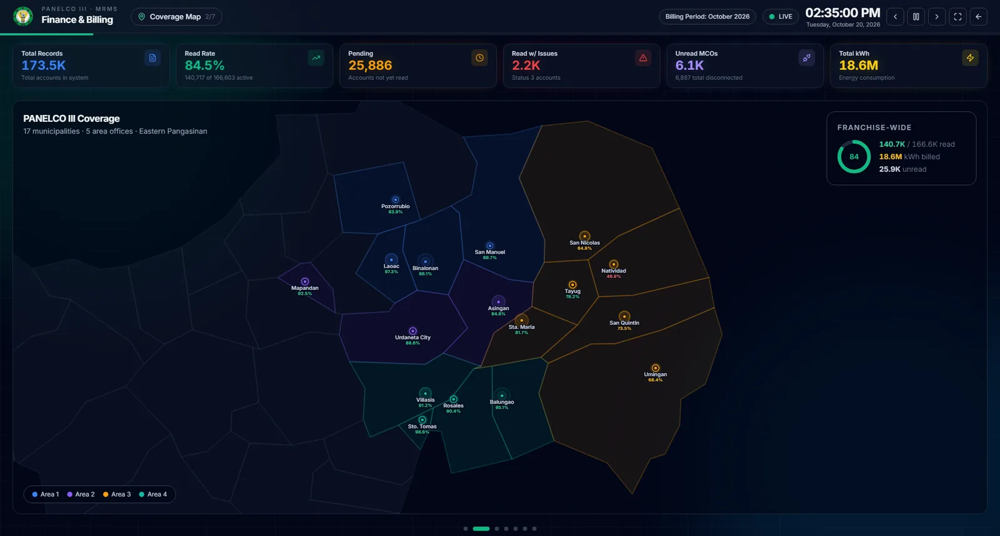
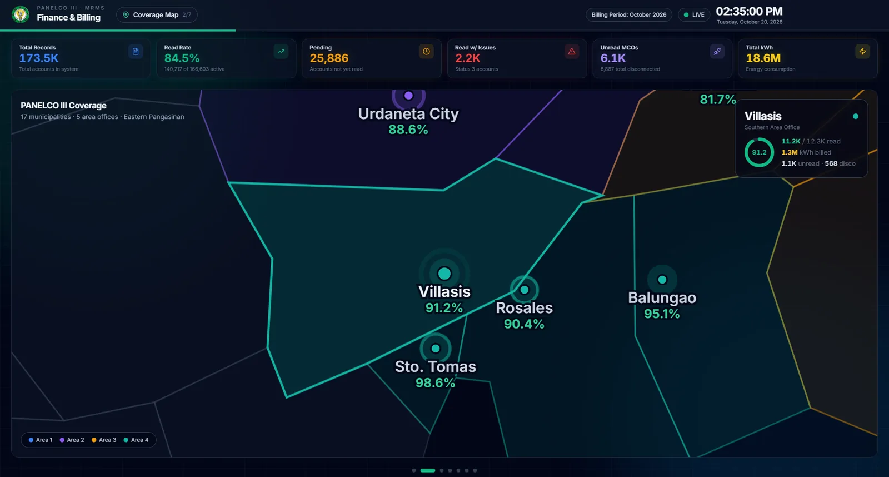
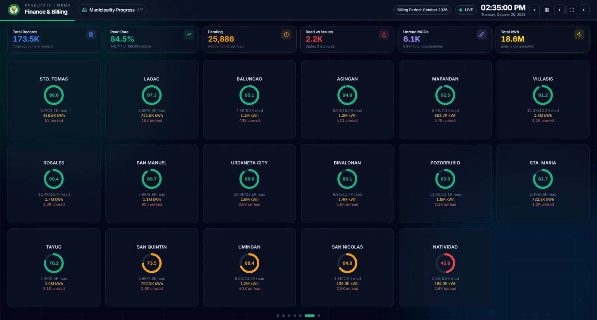
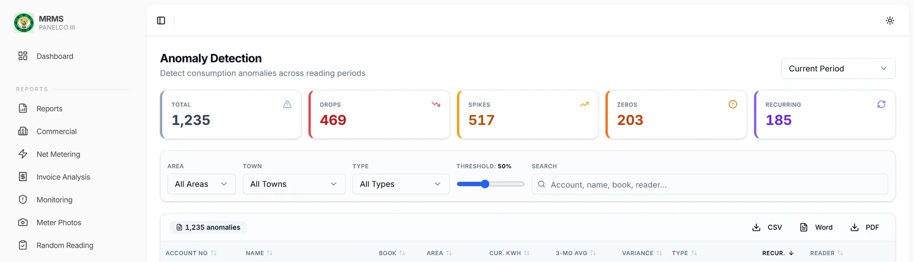
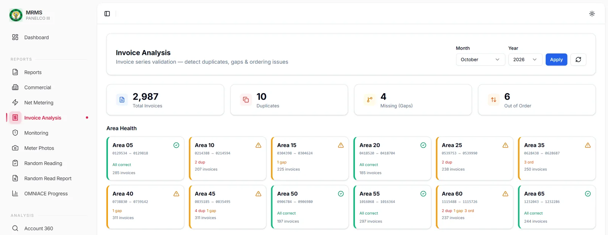
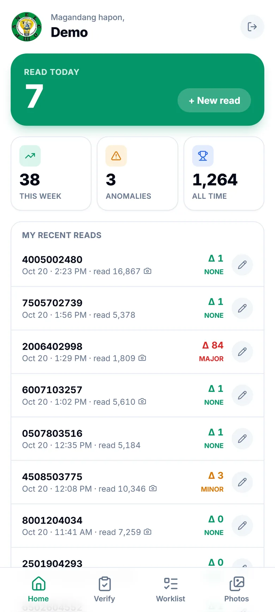

# Meter Reading Platform: Legacy Modernization

> Modernized a live billing-critical system with no data migration and no downtime, then turned it into a tool that finds lost revenue.

**Status:** In production · **Client:** Electric distribution cooperative with ~200,000 consumer accounts · **Role:** Solo full-stack engineer

**Stack:** `React 18` `Fastify` `Prisma` `MySQL` `Legacy Modernization`

> [!NOTE]
> **Showcase repository.** The source code is private and belongs to the client. This repo documents the problem, the architecture, and the results. Screens show demo data. Full case study: https://lesjohnpauloliver.dev/work/meter-reading-platform-legacy-modernization

## Summary

Rebuilt a production PHP and jQuery meter reading system as a React and Fastify app on the same live database, then grew it into the cooperative's operations hub: live cycle tracking, revenue-leak detection, reader scoring, and verified backups.

## Scale

- ~200,000 consumer accounts across 17 municipalities
- ~25 route-level modules in the new React app
- 10+ report types with PDF and CSV export
- Legacy and modern stacks run side by side on the same production database
- Before: 9 of 14 modules logged nothing

## The problem

- Knowing the billing cycle's status meant calling around and adding up per-book reports by hand, so lagging towns were found after the deadline.
- Revenue leaks were invisible: sudden drops in readings, "disconnected" meters still turning, and gaps or duplicates in invoice numbers.
- Reader performance and the outside contractor's readings were judged on opinion.
- There was no audit trail, backups were manual, and certain report queries crashed the production database server.

## Problem → fix

### Knowing the billing cycle's status meant calling around and adding up per-book reports by hand, so lagging towns were found after the deadline.

A live dashboard refreshes every 30 seconds with KPI cards, per-day progress, and drill-down to four area gauges and 17 town cards, with 12 months of trends behind it.

Operations dashboard: total accounts, read rate, pending and problem reads, and energy billed, with daily reading progress and completion.

Area and town progress: read, unread, and disconnected accounts for every area and municipality.

Month-over-month trends: completion rate, kWh billed, field issues, and average consumption across 12 billing periods.

The operations dashboard in dark mode.

### Management needed to spot a lagging town while there was still time to act.

TV mode puts a live coverage map on the operations room wall, flies the camera into each municipality, and ranks every town by completion. It unlocks with a kiosk key, no login.

TV mode: a live coverage map of every municipality in the franchise area, with read rates per town, built for the operations room wall.

TV mode drone camera: an animated fly-over that cycles through the towns.

TV mode town grid: reading completion for every municipality at a glance.

### Revenue leaks were invisible: sudden drops in readings, “disconnected” meters still turning, and gaps or duplicates in invoice numbers.

Each account is checked against its own 3-month average and flagged as a drop, spike, zero, or recurring anomaly with an estimated loss. Disconnected meters still consuming are ranked by kWh, and invoice series are checked for duplicates, gaps, and out-of-order numbers.

Anomaly detection: sudden drops, spikes, zero readings, and recurring anomalies flagged against each account's 3-month average.

Invoice analysis: duplicate, missing, and out-of-order invoice numbers caught per area before bills go out.

### Reader performance and the outside contractor's readings were judged on opinion.

A reader scorecard weighs completion, accuracy, productivity, books, and attendance, with per-day evidence behind every score. Staff re-read meters on site with a field app that logs photos, GPS, and the difference from the contractor's reading.

Field app for meter readers: today's reads, weekly totals, and anomalies flagged at capture time.

### The old system was billing-critical, so it could not go down for a rewrite.

The new React and Fastify app reads and writes the existing database exactly as the PHP system does, so modules moved over one at a time while both stacks ran side by side.

### There was no audit trail, backups were manual, and certain report queries crashed the production database server.

Every write is logged with a before and after diff. Backups run daily with checksums and verified copies, with an alert if the last good one is over 36 hours old. The crashing query was isolated and restructured.

## Approach

- Zero-migration compatibility: the new stack reads and writes the existing schema exactly as the PHP system does, so modules moved over one at a time.
- Correctness over convenience: the current billing period is derived from the data instead of a config row frozen for years, and every account falls into exactly one of five buckets so numbers agree everywhere.
- Field verification writes to a separate database; the contractor's readings stay strictly read-only.
- Answer management's questions directly: are we on track, where are we losing money, who is performing.

## What was built

- Live dashboard and a wall TV mode with a coverage map across all 17 towns
- Rule-based anomaly detection, disconnected-meter monitoring, and invoice series checks
- Account 360, reader scorecards, and contractor progress tracking
- Mobile field verification app with photos and GPS
- Audit log, user activity monitoring, and automated encrypted backups

## Capabilities

**Live cycle tracking**
- Dashboard with KPI cards, per-day reading progress, and a completion ring, refreshed every 30 s
- Area and town drill-down with four area gauges and 17 color-coded town cards
- TV mode: animated coverage map whose camera flies into each municipality, plus a town ranking
- TV display unlocks with a kiosk key, no login
- Dark mode

**Revenue protection**
- Anomaly detection: each account compared to its own 3-month average, flagged as drop, spike, zero, or recurring, with an estimated loss
- Disconnected consumer monitoring: "disconnected" meters still consuming, ranked by kWh, critical at 100 kWh or more
- Invoice analysis: duplicates, gaps, and out-of-order numbers per area
- Account 360: profile, billing, 12-month consumption, reading history, and field findings
- Exports to CSV, Word, and PDF

**People and contractors**
- Reader scorecard: completion 40%, accuracy 30%, productivity 15%, books 10%, attendance 5%
- Per-book and per-day evidence behind every score, with automatic Needs Improvement flags
- Contractor progress tracked book by book across five exclusive buckets, so completion cannot be padded

**Field app**
- Capacitor app with camera, GPS, local storage, and offline sync
- Staff re-read meters on site and log the difference from the contractor's reading
- Each check graded none, minor, or major
- Coverage-aware sampler builds the worklist so every consumer is visited over time

**Operations**
- Reports: status, summary, field findings, unread, time and motion, senior citizen, net metering, and more
- Assignment management: reassign or unassign books in bulk instead of rebuilding the month
- Reader schedules: a monthly route plan per reader, editable in place
- Commercial accounts tracked separately so none are left unread at cut-off
- Net metering: import and export readings and net excess energy for rooftop-solar consumers
- Trends: 12 months of completion, kWh, findings, and miss codes, with period drill-down

**Governance and security**
- Audit log on every write with a before/after diff, user, IP, and reason
- User activity: who is online, in which module, with session-conflict detection and forced logout
- 4-level RBAC enforced on routes and the API
- JWT access and refresh tokens with server-side session termination, bcrypt passwords, Zod validation
- AES-256-GCM encryption for stored backup-share credentials

**Backups**
- Scheduled daily backups with a weekly full, copied to several locations
- gzip and a SHA-256 checksum per file, and every copy verified by a round trip
- Dashboard alert if the last good backup is more than 36 hours old
- Live table-by-table progress for manual runs, with history and downloads

## Architecture

- React 18 and TypeScript SPA (TanStack Query, Zustand, Recharts, shadcn/ui) talking to a Fastify API with Zod validation.
- Existing production MySQL schema accessed through Prisma introspection, with raw SQL for complex reports over per-month history tables.
- A separate SQL Server database holds field verification records.
- Runs as a Windows service with secure public access through a tunnel; the legacy PHP system keeps running in parallel.

## Engineering

- Diagnosed a production database crash: isolated the query that triggered an engine bug and restructured it, with no upgrade, migration, or disruption to other systems on the server.
- Strict allowlist validation for dynamic table names in raw SQL.
- Kiosk key travels in the URL fragment so it never reaches server or proxy logs, and it unlocks only an allowlisted set of read endpoints.
- Streaming keyset-paginated backups keep memory flat regardless of table size.
- N+1 queries removed, index-friendly date ranges, request de-duplication, short-lived caching for hot dashboard queries, and route-level code splitting.
- README screenshots are real renders of the app fed by a seeded synthetic-data pipeline that fails closed, so no real record can leak into an image.

## Where AI does the work

Rule-based detectors do the watching: every account is checked against its own baseline, and drops, spikes, still-running disconnected meters, and invoice gaps land in an inspection queue with an estimated loss.

## Outcome

- Legacy and modern stacks run side by side against the live database, with no data migration and no downtime.
- Management sees the billing cycle live, and lagging towns show up while there is still time to act.

---

Built by **[Les John Paul Oliver](https://lesjohnpauloliver.dev)**, AI Engineer in the Philippines: agentic AI, RAG, LLM evals, MCP, and business automation. [Case studies](https://lesjohnpauloliver.dev/#projects) · [Hire me](https://lesjohnpauloliver.dev/ai-engineer-philippines)
